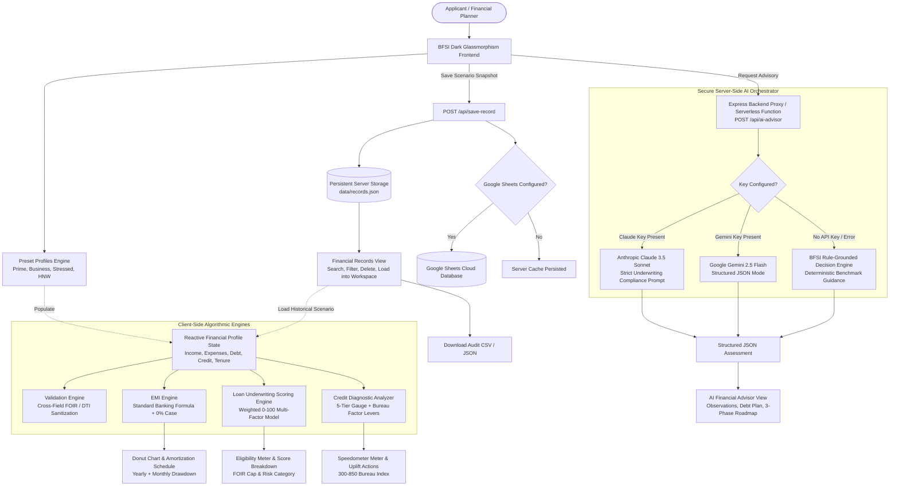

# BFSI Financial Decision-Making System Workflow

Below is the complete architectural and decision-flow diagram for FinDecision.AI, illustrating user input processing, underwriting scoring, AI decision advisory brokering, and persistent records management.

